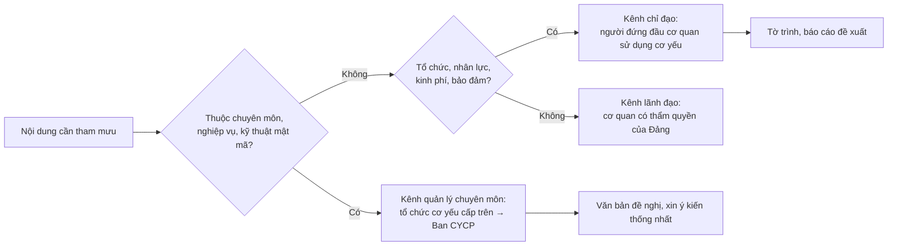
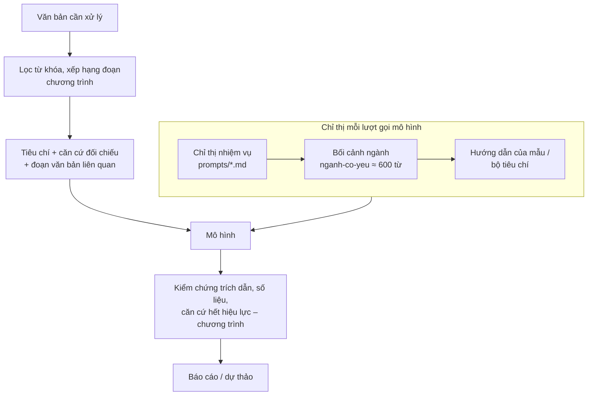

# BỘ KỸ NĂNG NGÀNH CƠ YẾU CỦA AI LOCAL (phiên bản 1.3.2)

Căn cứ xây dựng: Luật Cơ yếu số 05/2011/QH13; Luật An ninh mạng số 116/2025/QH15.

## Danh mục chữ viết tắt

| Viết tắt | Nội dung |
|---|---|
| ANM | An ninh mạng |
| BMNN | Bí mật nhà nước |
| BQP | Bộ Quốc phòng |
| BCA | Bộ Công an |
| Ban CYCP | Ban Cơ yếu Chính phủ |
| CPU | Bộ xử lý trung tâm |
| HTTT | Hệ thống thông tin |
| LCY | Luật Cơ yếu số 05/2011/QH13 |
| LANM | Luật An ninh mạng số 116/2025/QH15 |
| SPMM | Sản phẩm mật mã |

## Danh mục hình

- Hình 1. Vị trí của các kỹ năng trong một lượt xử lý văn bản
- Hình 2. Xác định kênh văn bản theo ba mối quan hệ công tác

## Danh mục bảng

- Bảng 1. Danh sách kỹ năng sau khi viết lại
- Bảng 2. Nhóm tiêu chí phân tích và căn cứ
- Bảng 3. Phần việc do chương trình và do mô hình đảm nhiệm
- Bảng 4. Hướng dẫn cán bộ chuyên môn tự điều chỉnh

---

## 1. Mục đích, yêu cầu

Bộ kỹ năng trước (1.3.0) xây dựng theo lĩnh vực chung "bảo mật thông tin, cơ yếu, chứng thực số", chưa gắn với điều, khoản cụ thể, chưa phân biệt kênh công tác. Bộ kỹ năng 1.3.2 viết lại theo hai luật để AI Local:

1. Đọc văn bản theo đúng câu hỏi của cán bộ tham mưu cơ yếu, mỗi nhận định kèm căn cứ để cán bộ kiểm tra lại.
2. Xác định đúng kênh: nội dung nào báo cáo người đứng đầu cơ quan, nội dung nào xin ý kiến tổ chức cơ yếu cấp trên.
3. Phát hiện căn cứ pháp lý đã hết hiệu lực (Luật An toàn thông tin mạng 2015, Luật An ninh mạng 2018 hết hiệu lực từ 01/7/2026).
4. Bảo đảm chạy được trên máy chủ chỉ có CPU.

## 2. Danh sách kỹ năng

**Bảng 1. Danh sách kỹ năng sau khi viết lại**

Bộ kỹ năng 1.3.2 **thay thế** bộ kỹ năng cũ: giữ nguyên danh mục 10 kỹ năng, viết lại toàn bộ nội dung theo hai luật; không bổ sung mẫu mới. Các loại văn bản luật định phát sinh (báo cáo sự cố, báo cáo tự kiểm tra an ninh mạng, đề nghị triển khai SPMM) được đưa vào mẫu báo cáo.

| Kỹ năng | Loại | Nội dung viết lại | Căn cứ chính |
|---|---|---|---|
| `phan-tich-co-yeu` (thay `phan-tich-bmtt-cy-cts`) | Bộ tiêu chí ngành | 20 tiêu chí, 8 nhóm, mỗi tiêu chí có `can_cu` | LCY, LANM (Bảng 2) |
| `phan-tich-chung` | Bộ tiêu chí rút gọn | 7 tiêu chí cho văn bản ngoài chuyên ngành: kênh công tác, nhiệm vụ của tổ chức cơ yếu, bảo vệ BMNN, an ninh mạng, căn cứ hiệu lực | Đ5, 8, 9, 16, 21, 22 LCY; Đ8–11, 40, 44 LANM |
| `soan-to-trinh` | Mẫu soạn thảo | Nơi trình theo kênh; phần "Bảo đảm bí mật, an toàn" | Đ16, 18, 22 LCY |
| `soan-bao-cao-de-xuat` | Mẫu soạn thảo | Báo cáo công tác; **gộp** báo cáo sự cố, báo cáo tự kiểm tra an ninh mạng, văn bản đề nghị triển khai SPMM (từ 1.4.0) | Đ8, 16, 18, 19, 22 LCY; Đ11, 40, 45 LANM |
| `soan-ke-hoach` | Mẫu soạn thảo | Bước xin thống nhất chuyên môn; phần "Bảo đảm bí mật, an toàn" | Đ5, 17, 18, 19 LCY |
| `soan-cong-van-gop-y` | Mẫu soạn thảo + cấu hình tham gia ý kiến | Kết cấu Căn cứ → Nội dung tham gia ý kiến → Đề xuất, kiến nghị; danh mục thuật ngữ, căn cứ bắt buộc, khía cạnh rà soát (từ 1.4.0, xem `docs/kho-van-ban-va-tham-gia-y-kien.md`) | Đ3, 6, 9 LCY; Đ2, 44 LANM |
| `tom-tat-van-ban` | Mẫu tổng hợp | Nhiệm vụ đối với tổ chức cơ yếu, kênh xử lý, yêu cầu bảo vệ BMNN, căn cứ hết hiệu lực | Đ8, 22 LCY; Đ44 LANM |
| `tong-hop-bao-cao-chung` | Mẫu tổng hợp (mặc định) | Theo các mặt công tác cơ yếu; liệt kê đủ sự cố; tách kiến nghị theo kênh | Đ8, 19, 22 LCY; Đ40 LANM |
| `tong-hop-bao-cao-tuan` | Mẫu tổng hợp | Như trên, kỳ tuần | Đ8, 19, 22 LCY; Đ40 LANM |
| `tong-hop-y-kien` | Mẫu tổng hợp | Đánh dấu ý kiến về thẩm quyền, mã hóa BMNN, căn cứ hết hiệu lực, thuật ngữ | Đ3, 6, 9, 22 LCY; Đ2, 11, 39, 44 LANM |

Kỹ năng `nganh-co-yeu` không phải mẫu người dùng chọn (không hiện trong danh mục): là phần bối cảnh ngành dùng chung, được nạp vào chỉ thị của các kỹ năng trên và chứa danh mục văn bản hết hiệu lực. Tách riêng để nội dung luật chỉ viết một lần, sửa một chỗ.

Hai luật được chuyển thành Markdown có cấu trúc Chương – Điều – Khoản trong `kb-nganh/van-ban/`, nạp vào kho văn bản chuẩn (Luồng B) bằng `python -m tools.seed ../kb-nganh`. Tài liệu tra cứu cho cán bộ: `skills/nganh-co-yeu/tham-chieu.md`.

## 3. Quan điểm xây dựng

### 3.1. Mỗi tiêu chí là một câu hỏi nghiệp vụ gắn với điều, khoản

Một tiêu chí cũ chỉ hỏi "văn bản có yêu cầu gì về sản phẩm mật mã". Tiêu chí mới hỏi theo đúng nghĩa vụ luật định, ví dụ Điều 17 LCY: triển khai, giải thể mạng liên lạc cơ yếu đã có văn bản thống nhất chuyên môn của Ban CYCP chưa. Câu hỏi càng cụ thể, mô hình nhỏ trên CPU càng trả lời đúng trọng tâm. Trường `can_cu` được đưa vào chỉ thị và in ra báo cáo, nên cán bộ đối chiếu được ngay; mô hình chỉ được kết luận "trái" hoặc "thiếu" khi nội dung điều luật có trong nguồn, nếu không thì ghi "cần đối chiếu".

**Bảng 2. Nhóm tiêu chí phân tích và căn cứ**

| Nhóm | Số tiêu chí | Căn cứ |
|---|---|---|
| Thẩm quyền, quan hệ công tác | 2 | Đ6, 21, 22 LCY; Đ11, 15, 18, 39, 40 LANM |
| Mật mã bảo vệ BMNN | 5 | Đ8, 9, 11, 13, 15–19 LCY; Đ15 LANM |
| Mật mã dân sự, chứng thực số | 3 | Khoản 20 Đ2, Đ26, 27 LANM; quy định chữ ký số chuyên dùng |
| An ninh mạng HTTT | 4 | Đ8–11, 18, 20, 23, 40 LANM |
| Nhân sự cơ yếu | 2 | Đ23–36 LCY |
| Căn cứ, hiệu lực | 1 | Đ44, 45 LANM; Đ37 LCY |
| Bảo đảm | 1 | Đ10, 16 LCY |
| Hành vi cấm, rủi ro | 2 | Đ5, 11 LCY; Đ7 LANM |

Nhóm thẩm quyền và mật mã bảo vệ BMNN đặt đầu danh sách vì khi giới hạn số tiêu chí (`AGENT_MAX_CRITERIA`), các nội dung trọng tâm của ngành luôn được xét trước.

### 3.2. Ba mối quan hệ công tác quyết định kênh văn bản

Khoản 3 Điều 22 LCY quy định tổ chức cơ yếu bộ, ngành chịu sự lãnh đạo của cơ quan có thẩm quyền của Đảng, sự chỉ đạo của người đứng đầu cơ quan sử dụng cơ yếu và sự quản lý chuyên môn, nghiệp vụ của tổ chức cơ yếu cấp trên. Đây là điểm khác biệt chủ yếu giữa văn bản tham mưu của ngành Cơ yếu và văn bản hành chính thông thường, nên được đưa vào kỹ năng bối cảnh ngành và vào hướng dẫn của từng mẫu soạn thảo.

*Hình 2. Xác định kênh văn bản theo ba mối quan hệ công tác*

Ví dụ: mẫu `soan-to-trinh` không để mô hình tự quyết định nội dung kỹ thuật mật mã mà viết "đề nghị tổ chức cơ yếu cấp trên thống nhất"; mẫu `soan-bao-cao-de-xuat` khi dùng cho báo cáo sự cố nêu nơi nhận theo loại sự cố (SPMM → tổ chức cơ yếu cấp trên; HTTT quân sự → cơ quan chuyên trách của BQP theo khoản 1 Điều 40 LANM).

### 3.3. Phân định thẩm quyền theo Luật An ninh mạng 2025

LANM giao BCA làm đầu mối quản lý nhà nước, nhưng loại trừ HTTT quân sự (BQP) và HTTT cơ yếu (Ban CYCP) ở các Điều 11, 15, 18, 20, 39. Nếu không có bối cảnh này, mô hình dễ viết "đề nghị Bộ Công an kiểm tra" đối với hệ thống quân sự. Kỹ năng bối cảnh ngành và mẫu `soan-bao-cao-de-xuat` (phần báo cáo tự kiểm tra) nêu rõ phân định này. Kỹ năng cũng yêu cầu phân biệt mật mã cơ yếu (bảo vệ BMNN) với mật mã dân sự (khoản 20 Điều 2 LANM).

### 3.4. Phần xác định được thì giao cho chương trình

**Bảng 3. Phần việc do chương trình và do mô hình đảm nhiệm**

| Việc | Đảm nhiệm | Lý do |
|---|---|---|
| Nhận diện số hiệu văn bản (kể cả số hiệu luật `…/QH13`, `…/PL-UBTVQH10`) | Chương trình | Biểu thức chính quy, không sai |
| Phát hiện căn cứ hết hiệu lực | Chương trình | Đối chiếu danh mục `van_ban_het_hieu_luc`; không phụ thuộc mô hình |
| Lọc tiêu chí theo từ khóa | Chương trình | Tiêu chí không liên quan không gọi mô hình – tiết kiệm thời gian CPU |
| Tra nguyên văn điều, khoản theo tên luật ("Điều 22 Luật Cơ yếu") | Chương trình | Kho văn bản chuẩn, không dùng vector |
| Nhận định theo tiêu chí, viết từng phần văn bản | Mô hình | Có căn cứ đối chiếu, trích dẫn được kiểm tra |

Danh mục văn bản hết hiệu lực có trường `chi_khi_kem` để tránh báo nhầm: Luật số 35/2018/QH14 sửa đổi 37 luật, chỉ bị báo khi văn bản cùng viện dẫn Luật An toàn thông tin mạng 86/2015/QH13.

### 3.5. Ngắn gọn để chạy trên CPU

*Hình 1. Vị trí của các kỹ năng trong một lượt xử lý văn bản*

Phần bối cảnh ngành được đưa vào mọi lượt gọi, nên giữ khoảng 600 từ; nội dung chi tiết để cán bộ tra cứu đặt ở `tham-chieu.md` và không đưa vào chỉ thị. Nguyên văn điều luật được truy xuất từ kho văn bản chuẩn khi cần, không nạp toàn bộ hai luật vào chỉ thị. Khi cần đo thời gian, tắt bối cảnh ngành bằng `DOMAIN_CONTEXT=0`. Với tổng hợp báo cáo, bối cảnh ngành chỉ đưa vào bước tổng hợp cuối, không đưa vào bước đọc từng báo cáo.

### 3.6. Không suy đoán thông tin thuộc bí mật nhà nước

Theo Điều 8 LCY, SPMM, thông tin về tổ chức, mạng liên lạc cơ yếu, nơi làm việc, kho cất giữ là BMNN. Các kỹ năng yêu cầu chỉ nêu đúng như nguồn, không tự tổng hợp; các mẫu báo cáo (sự cố, tự kiểm tra, đề nghị triển khai SPMM) đều nhắc cán bộ xác định độ mật trước khi ban hành.

## 4. Giới hạn

1. Chưa có nghị định, thông tư hướng dẫn hai luật và văn bản về chữ ký số, dịch vụ chứng thực chữ ký số chuyên dùng. Tiêu chí `cy09`, `cy10` hiện chỉ hỏi theo nội dung văn bản được phân tích; cần nạp các văn bản này vào kho văn bản chuẩn để có căn cứ đối chiếu.
2. Danh mục văn bản hết hiệu lực do cán bộ cập nhật thủ công trong `skills/nganh-co-yeu/SKILL.md`.
3. Nhận định của mô hình là ý kiến tham khảo; kết luận "trái quy định" cần cán bộ đối chiếu nguyên văn.

## 5. Tự điều chỉnh

**Bảng 4. Hướng dẫn cán bộ chuyên môn tự điều chỉnh**

| Việc cần làm | Tệp | Ghi chú |
|---|---|---|
| Thêm, sửa tiêu chí | `skills/phan-tich-co-yeu/SKILL.md` | Mỗi tiêu chí có `hoi`, `can_cu`, `tu_khoa` (cụm có dấu, nhiều âm tiết) |
| Thêm văn bản hết hiệu lực | `skills/nganh-co-yeu/SKILL.md` → `van_ban_het_hieu_luc` | `so_hieu`, `thay_the_boi`, `can_cu`; `ten_nhan_dien` nếu văn bản hay được gọi theo tên |
| Sửa bối cảnh ngành | `skills/nganh-co-yeu/SKILL.md` (phần thân) | Giữ dưới khoảng 800 từ |
| Sửa mẫu văn bản | `skills/soan-<loại>/SKILL.md` + `the-thuc.md` | Từ khóa định tuyến trong `DRAFT_MAP` (services/orchestrator/pipelines.py) |
| Thêm thuật ngữ | `glossary/thuat-ngu.md` | Đã có định nghĩa theo Điều 3 LCY, Điều 2 LANM |

Các tệp kỹ năng được đọc lại khi thay đổi, không cần khởi động lại dịch vụ.
