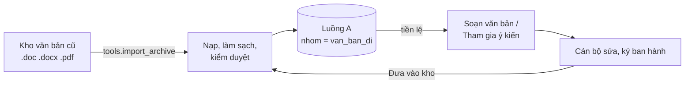
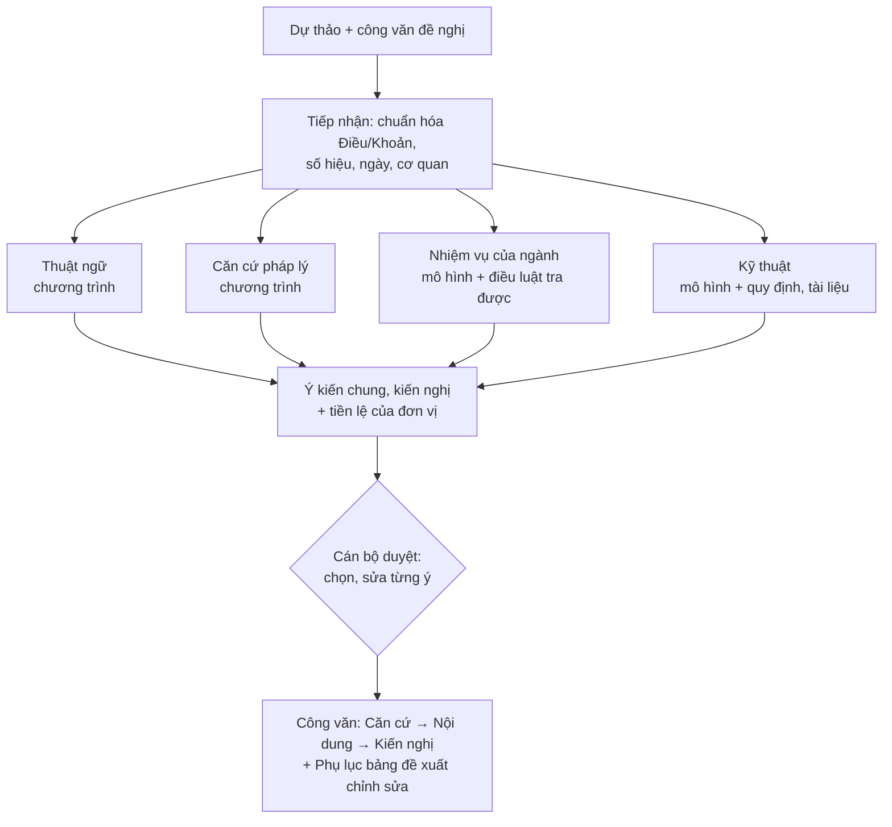

# KHAI THÁC KHO VĂN BẢN ĐÃ BAN HÀNH VÀ THAM GIA Ý KIẾN DỰ THẢO (phiên bản 1.4.1)

## Danh mục chữ viết tắt

| Viết tắt | Nội dung |
|---|---|
| BMNN | Bí mật nhà nước |
| CPU | Bộ xử lý trung tâm |
| LANM | Luật An ninh mạng số 116/2025/QH15 |
| LCY | Luật Cơ yếu số 05/2011/QH13 |
| VBD | Văn bản đơn vị đã ban hành (nhóm `van_ban_di`) |

## Danh mục hình

- Hình 1. Vòng khai thác kho văn bản đã ban hành
- Hình 2. Quy trình tác vụ tham gia ý kiến dự thảo

## Danh mục bảng

- Bảng 1. Cách AI Local sử dụng văn bản đã ban hành
- Bảng 2. Khía cạnh rà soát và phần việc của chương trình, mô hình
- Bảng 3. Tham số, tệp điều chỉnh

---

## 1. Kho văn bản đã ban hành

### 1.1. Nạp kho văn bản cũ

Văn bản đơn vị đã ký ban hành (tờ trình, công văn tham gia ý kiến, báo cáo…) được nạp vào Luồng A với nhóm `van_ban_di`:

```bash
# Kiểm tra danh sách tệp sẽ nạp
python -m tools.import_archive /du-lieu/van-ban-di --thu
# Nạp, đưa vào hàng chờ kiểm duyệt (mặc định)
python -m tools.import_archive /du-lieu/van-ban-di --don-vi chung --do-mat 0
# Kho đã được rà soát trước: duyệt Luồng A ngay bằng tài khoản hệ thống (ghi vết đầy đủ)
python -m tools.import_archive /du-lieu/van-ban-di --duyet
```

- Hỗ trợ `.doc .docx .pdf .md .txt .odt .rtf`, duyệt thư mục con. Tệp `.doc` cũ được chuyển bằng LibreOffice chạy cục bộ; ảnh máy chủ cần xây dựng với `INSTALL_LIBREOFFICE=1`.
- Tệp trùng hoàn toàn (theo mã băm) được bỏ qua; chạy lại nhiều lần an toàn.
- Trên giao diện **Nạp dữ liệu**: chọn **Nhóm = Văn bản đơn vị đã ban hành**.
- Văn bản có độ mật vượt cấp độ hệ thống được phép xử lý bị phân hệ nạp từ chối; `--do-mat` phải khai đúng.

### 1.2. Cách sử dụng

**Bảng 1. Cách AI Local sử dụng văn bản đã ban hành**

| Mục đích | Cách làm | Giới hạn |
|---|---|---|
| Giữ nhất quán quan điểm | Khi tham gia ý kiến, mỗi đoạn dự thảo được so với ý kiến đơn vị đã tham gia trước đây (đoạn gần nhất) | Chỉ tham khảo, không thay căn cứ pháp lý |
| Học cách viết của đơn vị | Văn bản cùng chủ đề đưa vào nguồn khi soạn tờ trình, báo cáo, kế hoạch, công văn (nhãn "văn bản đơn vị đã ban hành") | Không chép số liệu, thời hạn, tên người của văn bản cũ |
| Hiển thị cho cán bộ | Màn hình duyệt ý kiến có mục "Ý kiến đơn vị đã tham gia trước đây"; phụ lục làm việc liệt kê tiền lệ | — |
| Bổ sung kho liên tục | Nút **Đưa vào kho văn bản đã ban hành** trên tác vụ đã hoàn thành (sau khi ký) | Qua hàng chờ kiểm duyệt như mọi tài liệu |

Hỏi đáp và thu thập căn cứ thông thường **loại trừ** nhóm `van_ban_di` (bộ lọc `bo_nhom`), để văn bản cũ không bị dùng làm căn cứ pháp lý.



*Hình 1. Vòng khai thác kho văn bản đã ban hành*

## 2. Tham gia ý kiến dự thảo

### 2.1. Kết cấu công văn

1. **Căn cứ** – văn bản đề nghị tham gia ý kiến (cơ quan, số hiệu, ngày) và tên dự thảo; câu dẫn do chương trình ghép.
2. **Nội dung tham gia ý kiến** – 2.1. Ý kiến chung; 2.2–2.5. Ý kiến cụ thể theo khía cạnh. Mỗi ý gồm: vị trí (điều, khoản) → nhận xét → đề nghị sửa thành → căn cứ.
3. **Đề xuất, kiến nghị** – chỉ có khi cần; không có thì bỏ hẳn mục này.

Kèm theo là **Phụ lục: Bảng tổng hợp đề xuất chỉnh sửa** (vị trí | nội dung dự thảo | đề nghị chỉnh sửa | lý do, căn cứ). Ngoài bản sạch, hệ thống tạo **bản kèm nguồn tra cứu** để cán bộ rà soát.

### 2.2. Khía cạnh rà soát

**Bảng 2. Khía cạnh rà soát và phần việc của chương trình, mô hình**

| Khía cạnh | Đảm nhiệm | Nội dung |
|---|---|---|
| Thuật ngữ chuyên môn | Chương trình | (1) Danh mục "dùng đúng ↔ cần tránh" trong kỹ năng (mật mã dân sự, sản phẩm mật mã, mạng liên lạc cơ yếu, Ban Cơ yếu Chính phủ…); bỏ qua tên luật được viện dẫn. (2) Định nghĩa trong điều "Giải thích từ ngữ" của dự thảo được so với định nghĩa trong kho văn bản chuẩn; khác nhiều thì đề nghị thống nhất, kèm **nguyên văn** định nghĩa của luật |
| Căn cứ pháp lý | Chương trình | Căn cứ hết hiệu lực (danh mục trong `nganh-co-yeu`); trạng thái trong kho; thiếu căn cứ bắt buộc theo nội dung (mật mã → Luật Cơ yếu; an ninh mạng → LANM; chữ ký số → Luật Giao dịch điện tử) |
| Nhiệm vụ của ngành | Mô hình | Đoạn có chủ thể ngành (Ban Cơ yếu Chính phủ, tổ chức cơ yếu, Bộ Quốc phòng, Bộ Công an…) + điều luật tra từ kho → đúng chủ thể, đúng thẩm quyền chưa |
| Kỹ thuật (bảo mật, ký số, xác thực) | Mô hình | Đoạn về mã hóa, khóa, chữ ký số, chứng thư số, xác thực… + quy định, tài liệu kỹ thuật nội bộ |

Kiểm soát kết quả của mô hình:
- Vị trí (điều, khoản, điểm) do chương trình xác định từ cấu trúc dự thảo, không do mô hình viết.
- Căn cứ mô hình nêu phải có trong quy định đã tra được; nếu không, chương trình gắn "(cần đối chiếu)".
- Đề nghị sửa có số liệu không có trong dự thảo hoặc quy định được đánh dấu "(số liệu cần đối chiếu)".
- Ý kiến trùng giữa các khía cạnh (cùng vị trí, nội dung gần giống) được gộp.



*Hình 2. Quy trình tác vụ tham gia ý kiến dự thảo*

### 2.3. Sử dụng

Từ bản 1.4.1, tham gia ý kiến dự thảo là một **hình thức của loại văn bản Công văn** trong phân hệ **Soạn văn bản tham mưu** (không còn tiện ích riêng):

| Bước | Thao tác |
|---|---|
| 1 | Soạn văn bản tham mưu → Loại văn bản: **Công văn** |
| 2 | Hình thức công văn: **Trả lời, đề nghị** (soạn theo chủ đề, duyệt dàn ý) hoặc **Tham gia ý kiến dự thảo** |
| 3 | Với hình thức tham gia ý kiến: tải dự thảo (bắt buộc), công văn đề nghị (tùy chọn – hệ thống tự lấy số hiệu, ngày, cơ quan; có thể nhập tay); điền thể thức |
| 4 | Duyệt danh sách ý kiến → công văn hoàn chỉnh, xuất DOCX, đưa vào kho văn bản đã ban hành sau khi ký |

- Hình thức được khai báo trong mẫu (`che_do` của `skills/soan-cong-van-gop-y`); chỉ mẫu có cấu hình `gop_y` mới hiện lựa chọn Tham gia ý kiến.
- Nếu chọn Công văn, đính kèm tệp và chủ đề có cụm "tham gia ý kiến/góp ý", hệ thống tự chuyển sang hình thức Tham gia ý kiến; biểu mẫu cũng gợi ý chuyển khi chủ đề có các cụm này.
- Tác vụ thuộc loại **Soạn văn bản tham mưu**; tiêu đề cập nhật theo tên dự thảo sau bước tiếp nhận. Liên kết, API cũ (`/tac-vu/moi/gop_y`, `kind: "gop_y"`) được chuyển tự động.
- Hoặc trong trò chuyện: đính kèm dự thảo (và công văn đề nghị), gửi "tham gia ý kiến dự thảo này". Khi có hai tệp, tệp có chữ "dự thảo" ở tên hoặc đầu văn bản (hoặc dài hơn) được nhận là dự thảo.
- Màn hình duyệt: chọn/bỏ từng ý kiến, sửa nhận xét, đề nghị sửa, căn cứ; thêm ý kiến; sửa ý kiến chung, kiến nghị.

## 3. Điều chỉnh

**Bảng 3. Tham số, tệp điều chỉnh**

| Nội dung | Vị trí |
|---|---|
| Kết cấu, câu dẫn, ý kiến chung mẫu, thứ tự và bật/tắt khía cạnh | `skills/soan-cong-van-gop-y/SKILL.md` → `gop_y` |
| Danh mục thuật ngữ dùng đúng ↔ cần tránh | `gop_y.thuat_ngu` (`tranh` hoặc `tranh_regex`, `can_cu`, `ghi_chu`) |
| Căn cứ bắt buộc theo nội dung | `gop_y.can_cu_bat_buoc` |
| Từ khóa chọn đoạn cho khía cạnh nhiệm vụ, kỹ thuật | `gop_y.khia_canh[].tu_khoa` |
| Chỉ thị nhận xét từng đoạn | `prompts/gop-y-khia-canh.md` |
| Số đoạn tối đa mỗi khía cạnh gửi mô hình (CPU) | `AGENT_GOPY_MAX_PASSAGES` (mặc định 8) |
| Ngưỡng khác biệt định nghĩa | `AGENT_GOPY_DEF_SIMILARITY` (mặc định 0,5) |
| Số văn bản đã ban hành đưa vào khi soạn, góp ý | `AGENT_PRECEDENTS` (mặc định 2) |
| Chuyển đổi `.doc` cũ | `INSTALL_LIBREOFFICE=1` khi xây dựng ảnh; `OFFICE_CONVERT_TIMEOUT` |

## 4. Giới hạn

1. Đối chiếu định nghĩa và tra điều luật chỉ có tác dụng với văn bản đã nạp vào kho văn bản chuẩn. Cần nạp Luật Giao dịch điện tử, các nghị định, thông tư hướng dẫn và quy định về chữ ký số chuyên dùng để khía cạnh kỹ thuật có căn cứ đầy đủ.
2. Trên CPU, mỗi đoạn được mô hình nhận xét mất khoảng 20–60 giây. Với 8 đoạn cho mỗi khía cạnh mô hình, một dự thảo mất khoảng 5–15 phút.
3. Dự thảo dạng ảnh quét đi qua nhận dạng ký tự; vị trí điều, khoản phụ thuộc chất lượng nhận dạng.
