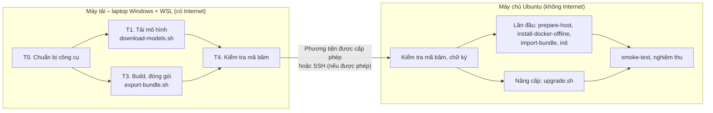
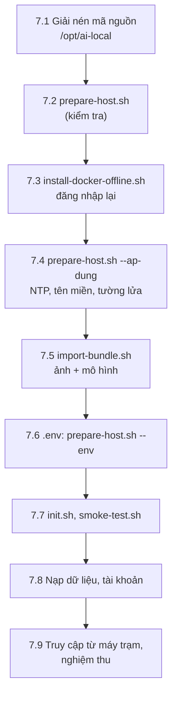
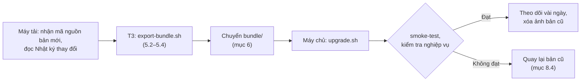

# HƯỚNG DẪN TẢI, ĐÓNG GÓI, TRIỂN KHAI VÀ NÂNG CẤP AI LOCAL TRÊN MÁY CHỦ UBUNTU KHÔNG KẾT NỐI INTERNET

Áp dụng cho phiên bản 1.4.4 trở lên. Cấu hình tham chiếu:
- Máy tải: laptop Windows có WSL2 (Ubuntu), Docker Desktop, VS Code, kết nối Internet.
- Máy chủ: Ubuntu Desktop 22.04/24.04, 20 nhân CPU, RAM 116 GB, không kết nối Internet, quản trị từ xa bằng SSH (PuTTY).

## Danh mục chữ viết tắt

| Viết tắt | Nội dung |
|---|---|
| CA | Tổ chức cấp chứng thư số (Certificate Authority) |
| CSDL | Cơ sở dữ liệu |
| GGUF | Định dạng tệp mô hình của llama.cpp |
| NTP | Giao thức đồng bộ thời gian |
| NUMA | Kiến trúc bộ nhớ không đồng nhất (máy nhiều socket CPU) |
| SSH | Giao thức truy cập từ xa có mã hóa |
| TLS | Giao thức bảo mật tầng truyền tải |
| WSL | Hệ thống con Linux trên Windows (Windows Subsystem for Linux) |

## Danh mục hình

- Hình 1. Toàn bộ quy trình: tải → đóng gói → chuyển giao → triển khai
- Hình 2. Trình tự triển khai lần đầu tại máy chủ
- Hình 3. Quy trình nâng cấp phiên bản

## Danh mục bảng

- Bảng 1. Thành phần cần chuyển giao
- Bảng 2. Các tệp script và ý nghĩa
- Bảng 3. Nhận biết terminal, cú pháp lệnh tương ứng
- Bảng 4. Tác vụ VS Code tại máy tải
- Bảng 5. Phân bổ tài nguyên dự kiến trên máy chủ 20 nhân, 116 GB RAM
- Bảng 6. Tham số `.env` khuyến nghị
- Bảng 7. Các loại nâng cấp và cách thực hiện
- Bảng 8. Xử lý sự cố thường gặp
- Bảng 9. Danh mục kiểm tra nghiệm thu

---

## 1. Tổng quan

Máy chủ không có Internet. Vì vậy mọi thành phần được chuẩn bị tại **máy tải**, đóng gói thành hai thư mục `bundle/` (phần mềm) và `out-models/gguf/` (mô hình), kiểm tra mã băm, chuyển vào máy chủ, sau đó cài đặt bằng script.



*Hình 1. Toàn bộ quy trình: tải → đóng gói → chuyển giao → triển khai*

**Bảng 1. Thành phần cần chuyển giao**

| Thành phần | Tạo bằng | Tác vụ VS Code | Dung lượng ước tính |
|---|---|---|---|
| Mô hình chính Qwen3.6-35B-A3B Q4_K_M | `download-models.sh` | T1 | ~21 GB |
| Mô hình embedding (Vietnamese_Embedding f16), reranker (bge-reranker-v2-m3 Q8_0) | `download-models.sh` | T1 | ~1,7 GB |
| Ảnh container (ứng dụng, Postgres, Redis, Qdrant, Keycloak, llama.cpp, LiteLLM, docling, Nginx…) | `export-bundle.sh` | T3 | 15–25 GB |
| Gói Python (xây dựng lại ảnh khi cần) | `export-bundle.sh` | T3 | ~1 GB |
| Bộ cài Docker Engine + Compose (.deb) | `download-docker-debs.sh` (gọi trong `export-bundle.sh`) | T3 (hoặc T2) | ~150 MB |
| Mã nguồn hệ thống (gồm `kb-nganh/` – hai luật) | `export-bundle.sh` | T3 | < 50 MB |

Khi nâng cấp phần mềm, chỉ cần chuyển `bundle/`. Mô hình chỉ chuyển lại khi đổi mô hình (mục 8).

## 2. Các tệp script và ý nghĩa

Toàn bộ script nằm trong thư mục `scripts/`, viết cho **bash** (Linux/WSL). Không chạy trực tiếp trong PowerShell.

**Bảng 2. Các tệp script và ý nghĩa**

| Script | Chạy ở đâu | Khi nào | Làm gì | Quyền |
|---|---|---|---|---|
| `download-models.sh` | Máy tải | Lần đầu; khi đổi mô hình | Tải mô hình từ Hugging Face. Mô hình embedding tiếng Việt được chuyển sang GGUF. Lập `MODELS-MANIFEST.yaml` (nguồn, phiên bản) và `SHA256SUMS` | Người dùng |
| `download-docker-debs.sh` | Máy tải | Lần đầu (được `export-bundle.sh` gọi khi có `UBUNTU_CODENAME`) | Tải bộ cài Docker Engine + Compose dạng `.deb`, kèm thư viện phụ thuộc, đúng phiên bản Ubuntu của máy chủ | Người dùng (cần Docker) |
| `export-bundle.sh` | Máy tải | Mỗi lần phát hành, nâng cấp | Build ảnh ứng dụng (kèm LibreOffice), tải ảnh mã nguồn mở, gói Python, mã nguồn, bộ cài Docker. Lập `SHA256SUMS`, ký số nếu có chứng thư. Thẻ ảnh lấy theo `.env.example` của bản đang đóng gói | Người dùng (cần Docker) |
| `prepare-host.sh` | Máy chủ | Lần đầu; khi thay phần cứng | Không tham số: chỉ kiểm tra phần cứng, phần mềm, in khuyến nghị. `--ap-dung`: tắt ngủ, tắt cập nhật tự động, đặt tham số nhân hệ điều hành, CPU chế độ hiệu năng. `--env .env`: ghi số luồng, ngữ cảnh, mô hình theo phần cứng | `--ap-dung` cần sudo |
| `install-docker-offline.sh` | Máy chủ | Lần đầu (máy chưa có Docker) | Kiểm tra mã băm. Chỉ cài gói `.deb` chưa có, không hạ cấp gói hệ điều hành. Cấu hình xoay vòng nhật ký, thêm người dùng vào nhóm `docker` | sudo |
| `import-bundle.sh` | Máy chủ | Lần đầu (lúc nâng cấp được `upgrade.sh` gọi) | Xác thực chữ ký, mã băm, quét mã độc (nếu có ClamAV). Nạp ảnh container (`docker load`), chép mô hình vào `models/` | Nhóm docker |
| `init.sh` | Máy chủ | Lần đầu (lúc nâng cấp được `upgrade.sh` gọi) | Sinh khóa bí mật cho các mục `__SINH_TU_DONG__`, sinh chứng thư TLS nội bộ nếu chưa có. Kiểm tra đủ mô hình, khởi động hệ thống, chờ sẵn sàng. **Chạy lại an toàn**: không đổi khóa, chứng thư đã có | Nhóm docker |
| `gen-certs.sh` | Máy chủ | Được `init.sh` gọi khi chưa có chứng thư | Sinh CA nội bộ (`config/pki/ca.crt`) và chứng thư máy chủ cho `AI_HOST` | Người dùng |
| `smoke-test.sh` | Máy chủ | Sau triển khai, nâng cấp | Kiểm tra dịch vụ, gọi thử mô hình, embedding. Đo tốc độ xử lý ngữ cảnh, tốc độ sinh, thời gian chờ ước tính | Nhóm docker |
| `backup.sh` | Máy chủ | Hằng ngày (cron); trước nâng cấp | Sao lưu CSDL PostgreSQL, snapshot Qdrant, kho văn bản chuẩn (git bundle), dữ liệu tài liệu, kèm `SHA256SUMS` | Nhóm docker |
| `upgrade.sh` | Máy chủ | Khi nâng cấp phiên bản | Kiểm tra gói, sao lưu, lưu bản mã nguồn cũ, cập nhật mã nguồn (giữ `.env`, chứng thư, mô hình), bổ sung tham số mới, chuyển thẻ ảnh, nạp ảnh, khởi động lại, kiểm tra. Cuối cùng in cách quay lại bản cũ | Nhóm docker |
| `lib-env.sh` | Dùng chung | Được các script khác nạp | Đọc `.env` theo cú pháp Docker Compose, không thực thi nội dung tệp như lệnh | – |

Công cụ Python (chạy trên máy chủ qua `docker compose --profile tools run --rm tools python -m <công cụ>`):
- `tools.seed`: nạp văn bản ban đầu (ví dụ hai luật trong `kb-nganh/`).
- `tools.import_archive`: nạp hàng loạt kho văn bản đã ban hành.
- `tools.reindex`: lập chỉ mục lại Luồng A, dùng khi đổi mô hình embedding hoặc khôi phục dữ liệu.

## 3. Chuẩn bị máy tải (một lần)

### 3.1. Terminal: PowerShell hay bash

Lỗi thường gặp nhất là gõ lệnh bash vào PowerShell, ví dụ báo `The token '&&' is not a valid statement separator` hoặc `UBUNTU_CODENAME=noble is not recognized`.

**Bảng 3. Nhận biết terminal, cú pháp lệnh tương ứng**

| Dấu nhắc | Terminal | Dùng cho |
|---|---|---|
| `PS C:\My Project\ai-local>` | PowerShell | `pscp`, `psftp` (PuTTY); gọi bash qua `wsl -d Ubuntu -e bash -lc "…"` |
| `user@may:/mnt/c/My Project/ai-local$` | Ubuntu (WSL) | Mọi lệnh trong tài liệu này có `. .venv-tai/…`, `VAR=… bash scripts/…`, `rsync`, `sha256sum` |

**Khuyến nghị:** đặt terminal mặc định của VS Code là WSL: `Ctrl+Shift+P` → *Terminal: Select Default Profile* → **Ubuntu (WSL)**. Sau đó mở terminal mới bằng `` Ctrl+` ``.

### 3.2. WSL, Docker Desktop

1. Trong PowerShell (quyền Administrator): `wsl --install -d Ubuntu`. Khởi động lại máy, mở Ubuntu một lần để tạo tài khoản.
2. Kiểm tra `wsl -l -v`. Bản mặc định (dấu `*`) phải là **Ubuntu**, không phải `docker-desktop`. Nếu sai: `wsl --set-default Ubuntu`. Bản `docker-desktop` không có `bash`; nếu nó là mặc định, lệnh sẽ báo `execvpe(bash) failed`.
3. Docker Desktop → *Settings → Resources → WSL integration* → bật cho Ubuntu → *Apply & restart*. Trong WSL, lệnh `docker version` phải hiện mục *Server*.
4. Trong WSL: `sudo apt update && sudo apt install -y python3-venv git curl`.

### 3.3. Môi trường Python cho việc tải (T0)

Tạo môi trường **trong WSL**. Nếu thư mục `.venv-tai` có `Scripts\` thay cho `bin/`, môi trường đã bị tạo bằng Python của Windows và không dùng được; xóa rồi tạo lại.

Dùng **Python 3.12** qua công cụ `uv`. Lý do: Python 3.14 (mặc định trên một số bản Ubuntu mới) không chạy được thư viện `protobuf` mà công cụ chuyển đổi của llama.cpp yêu cầu; lỗi hiện dạng `TypeError: Metaclasses with custom tp_new are not supported`.

```bash
cd "/mnt/c/My Project/ai-local"
curl -LsSf https://astral.sh/uv/install.sh | sh && export PATH=$HOME/.local/bin:$PATH
rm -rf .venv-tai && uv venv --python 3.12 .venv-tai
. .venv-tai/bin/activate
[ -d llama.cpp ] || git clone --depth 1 https://github.com/ggml-org/llama.cpp
uv pip install "huggingface_hub[cli]" -r llama.cpp/requirements/requirements-convert_hf_to_gguf.txt
python -c 'import sentencepiece.sentencepiece_model_pb2' && echo "Công cụ chuyển đổi: đạt"
```

**Bảng 4. Tác vụ VS Code tại máy tải** (`Ctrl+Shift+P` → *Tasks: Run Task*)

| Tác vụ | Nội dung | Lệnh tương đương (terminal WSL) |
|---|---|---|
| T0 | Chuẩn bị công cụ tải: môi trường Python 3.12, công cụ `hf`, llama.cpp (một lần; chạy lại sẽ tạo lại môi trường) | Mục 3.3 |
| T1 | Tải mô hình | `. .venv-tai/bin/activate && CAP=2 MODE=gguf WITH_SMALL=0 bash scripts/download-models.sh ./out-models` |
| T2 | Chỉ tải bộ cài Docker | `bash scripts/download-docker-debs.sh noble ./bundle/docker-debs` |
| T3 | Build, đóng gói | `. .venv-tai/bin/activate && UBUNTU_CODENAME=noble bash scripts/export-bundle.sh ./bundle` |
| T4 | Kiểm tra mã băm, dung lượng | Mục 5.4 |

Trên Windows, các tác vụ tự chạy qua `wsl`, nên bản mặc định của WSL phải là Ubuntu (mục 3.2).

## 4. Giai đoạn 1 – Tải mô hình (máy tải)

```bash
cd "/mnt/c/My Project/ai-local"
. .venv-tai/bin/activate
CAP=2 MODE=gguf WITH_SMALL=0 bash scripts/download-models.sh ./out-models
```

Ý nghĩa tham số:

| Tham số | Ý nghĩa |
|---|---|
| `CAP=2` | Mô hình chính Qwen3.6-35B-A3B (MoE, ~3 tỷ tham số kích hoạt mỗi token, chạy nhanh trên CPU) |
| `MODE=gguf` | Tải bản GGUF đã lượng tử hóa sẵn; riêng embedding tiếng Việt được chuyển đổi từ bản gốc |
| `WITH_SMALL=0` | Không tải mô hình nhỏ 9B (máy chủ CPU chỉ chạy mô hình chính) |
| `./out-models` | Thư mục kết quả |
| `QUANT=Q5_K_M` (tùy chọn) | Lượng tử khác (mặc định Q4_K_M) |

Script lần lượt làm:
1. Tải mô hình chính.
2. Tải và chuyển đổi embedding.
3. Tải reranker.
4. Lập manifest và `SHA256SUMS`.

Thời gian 30–90 phút. Nếu bị ngắt, chạy lại đúng lệnh; phần đã tải được giữ.

Kiểm tra kết quả:

```bash
ls -lh out-models/gguf/                               # qwen3.6-35b-a3b-Q4_K_M.gguf (~21G), vietnamese-embedding-f16.gguf (~1,1G), bge-reranker-v2-m3-Q8_0.gguf (~0,6G)
(cd out-models/gguf && sha256sum -c SHA256SUMS)       # 3 dòng OK
cat out-models/gguf/MODELS-MANIFEST.yaml
```

- Nếu `phien_ban` trong manifest để trống, ghi tay mã commit của từng kho (Hugging Face → *Files and versions*) để hồ sơ chuyển giao đủ nguồn gốc.
- Chỉ chuyển giao `out-models/gguf/`. Thư mục `out-models/src/` là bản tạm.

## 5. Giai đoạn 2 – Build, đóng gói phần mềm (máy tải)

**5.1. Xác định phiên bản Ubuntu của máy chủ** (qua PuTTY): `lsb_release -cs` cho kết quả `noble` (24.04) hoặc `jammy` (22.04).

**5.2. Kiểm tra ký tự xuống dòng.** Mã nguồn nằm trên ổ Windows; script có ký tự xuống dòng kiểu Windows (CRLF) sẽ báo lỗi `bash\r` trên máy chủ.

```bash
grep -lr $'\r' scripts/*.sh .env.example || echo "Không có CRLF – đạt"
# nếu có tệp bị liệt kê:  sed -i 's/\r$//' scripts/*.sh .env.example
```

**5.3. Đóng gói:**

```bash
. .venv-tai/bin/activate
UBUNTU_CODENAME=noble bash scripts/export-bundle.sh ./bundle
# có chứng thư ký số:  … export-bundle.sh ./bundle canbo.crt canbo.key
```

Dòng đầu tiên in ra `== Phiên bản đóng gói: 1.x.y` phải đúng phiên bản cần chuyển giao. Thời gian 30–60 phút; ổ C: cần trống khoảng 50 GB.

Kết quả trong `bundle/`:

| Thư mục/tệp | Nội dung |
|---|---|
| `images/*.tar` | Ảnh container |
| `images.lock` | Danh sách ảnh và mã định danh (digest) |
| `wheels/` | Gói Python |
| `docker-debs/<codename>/` | Bộ cài Docker |
| `source/ai-local.tar.gz` | Mã nguồn (không gồm `.env`, chứng thư, khóa, mô hình) |
| `manifest.yaml`, `SHA256SUMS`, `SHA256SUMS.p7s` | Hồ sơ đợt chuyển giao, mã băm, chữ ký số |

**5.4. Kiểm tra trước khi chuyển (T4):**

```bash
(cd bundle && sha256sum --quiet -c SHA256SUMS && echo "bundle: đạt")
(cd out-models/gguf && sha256sum --quiet -c SHA256SUMS && echo "mô hình: đạt")
du -sh bundle out-models/gguf
```

## 6. Giai đoạn 3 – Chuyển vào máy chủ

### 6.1. Qua phương tiện lưu trữ (khuyến nghị theo quy định)

Chép `bundle/` và `out-models/gguf/` ra phương tiện được cấp phép, quét mã độc tại trạm kiểm tra, rồi chép vào máy chủ, ví dụ `~/chuyen-giao/`.

### 6.2. Qua SSH từ laptop (chỉ khi được phép)

> Laptop đã kết nối Internet chỉ được nối vào mạng của máy chủ khi quy định bảo vệ bí mật nhà nước của đơn vị cho phép. Đề nghị xác nhận với bộ phận phụ trách an toàn thông tin trước khi thực hiện.

Trên máy chủ (PuTTY): `mkdir -p ~/chuyen-giao/gguf`

**Cách A – PuTTY (`pscp`), trong PowerShell:**

```powershell
pscp -r -P 22 "C:\My Project\ai-local\bundle" <user>@<ip-may-chu>:/home/<user>/chuyen-giao/
pscp -P 22 "C:\My Project\ai-local\out-models\gguf\*" <user>@<ip-may-chu>:/home/<user>/chuyen-giao/gguf/
```

`pscp` không tự tải tiếp khi bị ngắt. Nếu một tệp lớn bị ngắt giữa chừng, chuyển tiếp phần còn lại bằng `psftp`:

```powershell
psftp <user>@<ip-may-chu>
psftp> cd chuyen-giao/gguf
psftp> lcd "C:\My Project\ai-local\out-models\gguf"
psftp> reput qwen3.6-35b-a3b-Q4_K_M.gguf
psftp> quit
```

**Cách B – `rsync` trong WSL** (tự chuyển tiếp khi bị ngắt, có tiến độ):

```bash
rsync -avP --partial bundle out-models/gguf <user>@<ip-may-chu>:~/chuyen-giao/
```

### 6.3. Kiểm tra trên máy chủ

```bash
(cd ~/chuyen-giao/bundle && sha256sum --quiet -c SHA256SUMS && echo "bundle: đạt")
(cd ~/chuyen-giao/gguf && sha256sum -c SHA256SUMS)
```

## 7. Giai đoạn 4 – Triển khai lần đầu (máy chủ, qua PuTTY)



*Hình 2. Trình tự triển khai lần đầu tại máy chủ*

**7.1. Giải nén mã nguồn:**

```bash
sudo mkdir -p /opt/ai-local && sudo chown "$USER" /opt/ai-local
tar xzf ~/chuyen-giao/bundle/source/ai-local.tar.gz -C /opt/ai-local
cd /opt/ai-local
```

**7.2. Kiểm tra phần cứng** (không thay đổi gì): `scripts/prepare-host.sh`. Xử lý các mục **KHÔNG ĐẠT** trước khi làm tiếp.

**7.3. Cài Docker** (bỏ qua nếu máy đã có Docker bản `.deb`; nếu có Docker bản snap thì gỡ trước: `sudo snap remove docker`):

```bash
sudo scripts/install-docker-offline.sh ~/chuyen-giao/bundle/docker-debs/noble
exit        # đăng xuất, mở lại PuTTY để nhóm docker có hiệu lực
```

**7.4. Tinh chỉnh hệ điều hành:**

```bash
cd /opt/ai-local && sudo scripts/prepare-host.sh --ap-dung
```

Các việc cần làm thủ công:
- **Đồng bộ thời gian** với máy chủ NTP nội bộ. Lệch giờ làm hỏng đăng nhập (Keycloak) và việc kiểm tra chứng thư.
  ```bash
  sudo sed -i 's/^#\?NTP=.*/NTP=<ip-may-chu-ntp>/' /etc/systemd/timesyncd.conf && sudo systemctl restart systemd-timesyncd
  ```
- **Tên miền**: khai báo `ai.<don-vi>.local` trên DNS nội bộ. Nếu không có DNS, thêm vào tệp hosts của từng máy trạm.
- **Tường lửa**: cổng 80/443 do Docker mở **không chịu sự kiểm soát của UFW**. Hạn chế truy cập tại tường lửa mạng, hoặc bằng chuỗi `DOCKER-USER`, ví dụ:
  ```bash
  sudo iptables -I DOCKER-USER -p tcp -m multiport --dports 80,443 ! -s 10.10.0.0/16 -j DROP
  ```
- **Tùy chọn**: `sudo systemctl set-default multi-user.target` (khởi động không giao diện đồ họa, tiết kiệm 1–2 GB RAM).

**7.5. Nạp ảnh container và mô hình** (gói không ký số thì để trống tham số thứ 2):

```bash
scripts/import-bundle.sh ~/chuyen-giao/bundle "" ~/chuyen-giao/gguf
ls -lh models/
```

**7.6. Cấu hình `.env`:**

```bash
cp .env.example .env
scripts/prepare-host.sh --env .env      # tự ghi tham số CPU/RAM theo phần cứng thực tế
nano .env
```

**Bảng 5. Phân bổ tài nguyên dự kiến trên máy chủ 20 nhân, 116 GB RAM**

| Thành phần | Luồng CPU | RAM ước tính |
|---|---|---|
| Mô hình chính (35B-A3B Q4_K_M, ngữ cảnh 65 536, 3 phiên song song) | 16 | 25–30 GB |
| Embedding, reranker | 4 + 4 | ~3 GB |
| Chuyển đổi tài liệu, OCR (docling) | theo tải | 4–8 GB khi nạp tài liệu |
| PostgreSQL, Qdrant, Redis, Keycloak, các dịch vụ ứng dụng | theo tải | 8–12 GB |
| Ubuntu Desktop | – | 2–3 GB |
| **Tổng** | | **~45–55 GB, còn dư ~60 GB** |

Số luồng tính theo **nhân vật lý**. Script đọc `lscpu` và tự tính, nên kết quả đúng kể cả khi "20 nhân" thực ra là 10 nhân có siêu phân luồng. Tốc độ thực tế phải đo bằng `smoke-test.sh`.

**Bảng 6. Tham số `.env` khuyến nghị**

| Tham số | Giá trị | Ghi chú |
|---|---|---|
| `AI_HOST`, `AI_PUBLIC_URL` | `ai.<don-vi>.local`, `https://ai.<don-vi>.local` | Trùng tên trong chứng thư TLS |
| `LLM_MAIN_FILE` | `qwen3.6-35b-a3b-Q4_K_M.gguf` | Đúng tên tệp trong `models/` |
| `LLM_MAIN_THREADS` | 16 | Số nhân vật lý trừ 4 |
| `LLM_MAIN_CTX`, `LLM_MAIN_PARALLEL` | 65536, 3 | 3 phiên đồng thời |
| `LLM_MAIN_EXTRA` | `"--reasoning-budget 0"` | **Đặt trong ngoặc kép**. Máy có ≥ 2 vùng NUMA: thêm `--numa distribute` |
| `LLM_SMALL_URL` | `http://llm-main:8080/v1` | Không chạy mô hình nhỏ riêng |
| `EMBED_THREADS`, `RERANK_THREADS` | 4, 4 | |
| `CTX_BUDGET_SOURCES`, `ANSWER_MAX_TOKENS` | 6000, 1000 | Giảm nếu trả lời chậm |
| `SYSTEM_MAX_CLEARANCE` | 0 | Theo cấp độ hệ thống được phép xử lý |

Chứng thư TLS: khuyến nghị dùng chứng thư do PKI của đơn vị cấp. Đặt `server.crt`, `server.key`, `ca.crt` vào `config/pki/` trước bước 7.7. Nếu thư mục trống, `init.sh` tự sinh chứng thư nội bộ.

**7.7. Khởi động, kiểm tra:**

```bash
scripts/init.sh          # lần đầu 3–10 phút (nạp mô hình vào RAM)
scripts/smoke-test.sh    # tốc độ (token/giây), thời gian chờ ước tính
docker compose ps        # mọi dịch vụ running/healthy
```

Nếu thời gian chờ ước tính trên 60 giây: giảm `CTX_BUDGET_SOURCES` (4000–5000), rồi chạy `docker compose up -d`.

**7.8. Nạp dữ liệu, tài khoản:**

```bash
docker compose --profile tools run --rm tools python -m tools.seed /kb-nganh       # Luật Cơ yếu, Luật An ninh mạng 2025
docker compose --profile tools run --rm -v /du-lieu/van-ban-di:/van-ban-di:ro tools \
  python -m tools.import_archive /van-ban-di                                       # kho văn bản đã ban hành
```

Đăng nhập lần đầu bằng `quantri`, mật khẩu tạm `KC_INIT_ADMIN_PASSWORD` trong `.env`. Hệ thống bắt buộc đổi mật khẩu và cài OTP. Tạo người dùng, vai trò, nhóm đơn vị tại `https://<AI_HOST>/auth/admin/`.

**7.9. Truy cập từ máy trạm (ví dụ laptop):**
1. Thêm vào `C:\Windows\System32\drivers\etc\hosts` (mở Notepad bằng quyền Administrator) dòng `<ip-may-chu>  ai.<don-vi>.local`.
2. Nếu dùng chứng thư nội bộ, chép CA về rồi cài vào *Trusted Root Certification Authorities* (*Local Machine*):
   `pscp <user>@<ip-may-chu>:/opt/ai-local/config/pki/ca.crt "C:\Temp\ca-ai-local.crt"`
3. Nếu tường lửa chặn 443, dùng đường hầm của PuTTY: *Connection → SSH → Tunnels*, Source port `8443`, Destination `127.0.0.1:443`. Khi đó trỏ tên miền về `127.0.0.1` và đặt `AI_PUBLIC_URL` có kèm `:8443`.
4. Truy cập `https://ai.<don-vi>.local`, rồi nghiệm thu theo Bảng 9.

## 8. Nâng cấp phiên bản

### 8.1. Nguyên tắc

- **Dữ liệu nằm trong volume Docker** (`ai-local_pgdata`, `ai-local_qdrant`, `ai-local_kb`, `ai-local_appdata`…), không bị ảnh hưởng khi thay mã nguồn, thay ảnh.
- **Giữ nguyên của máy chủ**: `.env` (khóa bí mật, tham số đã tinh chỉnh), `config/pki/` (chứng thư), `models/`, `backups/`.
- **Ảnh container gắn thẻ theo phiên bản** (`ai-local/backend:1.x.y`). Ảnh bản cũ vẫn còn trên máy sau nâng cấp, nên quay lại bản cũ chỉ mất vài phút.
- **Luôn sao lưu trước khi nâng cấp.** `upgrade.sh` tự sao lưu, trừ khi chỉ định bỏ qua.
- Cấu trúc CSDL: hệ thống tự tạo bảng mới khi khởi động. Nếu bản mới thay đổi cột của bảng đã có, mục *Nhật ký thay đổi* trong README sẽ ghi rõ cần chuyển đổi CSDL kèm hướng dẫn. Đọc mục này trước mỗi lần nâng cấp.

**Bảng 7. Các loại nâng cấp và cách thực hiện**

| Loại | Chuyển giao | Thực hiện trên máy chủ |
|---|---|---|
| Phần mềm (phiên bản mới của AI Local) | `bundle/` | `scripts/upgrade.sh` (mục 8.2) |
| Mô hình ngôn ngữ chính (đổi mô hình, đổi mức lượng tử) | Tệp `.gguf` mới | Mục 8.3 |
| Mô hình embedding | Tệp `.gguf` mới | Mục 8.3 và **lập chỉ mục lại** |
| Chỉ đổi tham số | Không | Sửa `.env`, `docker compose up -d` |
| Docker Engine | `bundle/docker-debs/` mới | `sudo scripts/install-docker-offline.sh …`; hệ thống tự chạy lại sau khi Docker khởi động lại |

### 8.2. Nâng cấp phần mềm



*Hình 3. Quy trình nâng cấp phiên bản*

**Tại máy tải:**
1. Giải nén mã nguồn bản mới vào thư mục dự án (ghi đè). Giữ `.venv-tai/`, `llama.cpp/`, `out-models/` nếu có.
2. Đọc mục *Nhật ký thay đổi* trong README của bản mới.
3. Làm lại mục 5.2–5.4. Dòng `== Phiên bản đóng gói` phải là phiên bản mới.
4. Chuyển `bundle/` vào máy chủ (mục 6), kiểm tra mã băm (mục 6.3). Xóa `bundle/` cũ trên máy chủ trước khi chép để không lẫn.

**Tại máy chủ (PuTTY):**

```bash
cd /opt/ai-local
scripts/upgrade.sh ~/chuyen-giao/bundle             # gói không ký số
# scripts/upgrade.sh ~/chuyen-giao/bundle ca-noibo.crt    # gói có ký số
```

`upgrade.sh` thực hiện 7 bước, gặp lỗi ở bước nào thì dừng ở bước đó:

| Bước | Nội dung |
|---|---|
| 1 | Kiểm tra chữ ký số, mã băm của gói |
| 2 | Lưu bản mã nguồn cũ, kèm `.env` và chứng thư, vào `/opt/ai-local-ban-cu/ai-local-<bản cũ>-<thời điểm>.tgz`. Sao lưu dữ liệu bằng `backup.sh`; hệ thống phải đang chạy |
| 3 | Giải nén mã nguồn mới, **không** ghi đè `.env`, `config/pki/`, `models/`, `backups/`; chuẩn hóa ký tự xuống dòng của script |
| 4 | Lưu `.env` hiện tại thành `.env.truoc-nang-cap-<thời điểm>`. Bổ sung tham số mới với giá trị mặc định, chuyển `IMG_APP`, `IMG_PORTAL` sang thẻ bản mới, thêm ngoặc kép cho giá trị có dấu cách |
| 5 | Nạp ảnh container mới (`import-bundle.sh`) |
| 6 | Khởi động lại (`init.sh`), sinh khóa cho tham số bí mật mới nếu có, chờ sẵn sàng |
| 7 | `smoke-test.sh`, `docker compose ps`. In lệnh quay lại bản cũ |

Sau nâng cấp:
- So sánh `.env` với `.env.truoc-nang-cap-*` (`diff .env .env.truoc-nang-cap-*`), xem các tham số mới ở cuối tệp.
- Kiểm tra phiên bản đang chạy: `docker compose ps` (cột IMAGE là `ai-local/backend:<bản mới>`); kiểm tra nghiệp vụ chính (Bảng 9, các mục 7–9, 12).
- Sau vài ngày vận hành ổn định, xóa ảnh bản cũ theo lệnh `upgrade.sh` đã in ra.

### 8.3. Nâng cấp mô hình

1. Tại máy tải, tải mô hình mới, ví dụ bản Q5_K_M: `QUANT=Q5_K_M CAP=2 MODE=gguf WITH_SMALL=0 bash scripts/download-models.sh ./out-models-moi`. Chuyển `out-models-moi/gguf/` vào máy chủ, kiểm tra mã băm.
2. Tại máy chủ:
   ```bash
   cp ~/chuyen-giao/gguf/<tep-moi>.gguf /opt/ai-local/models/
   nano .env                                # LLM_MAIN_FILE=<tep-moi>.gguf (hoặc EMBED_FILE=…)
   docker compose up -d                     # chỉ khởi động lại dịch vụ có thay đổi
   scripts/smoke-test.sh
   ```
3. **Khi đổi mô hình embedding**, phải lập chỉ mục lại Luồng A, vì vector cũ không còn tương thích:
   ```bash
   docker compose --profile tools run --rm tools python -m tools.reindex
   ```
   Nếu số chiều vector thay đổi, xóa collection `tai_lieu` trong Qdrant trước (README, mục đổi mô hình embedding).
4. Giữ tệp mô hình cũ trong `models/` đến khi bản mới chạy ổn định. Quay lại bằng cách trả `LLM_MAIN_FILE` về giá trị cũ, rồi `docker compose up -d`.

### 8.4. Quay lại bản cũ, khôi phục dữ liệu

**Quay lại phần mềm bản cũ** (dữ liệu giữ nguyên):

```bash
cd /opt/ai-local && docker compose down
tar xzf /opt/ai-local-ban-cu/ai-local-<bản cũ>-<thời điểm>.tgz -C /opt/ai-local
docker compose up -d
```

**Khôi phục dữ liệu** (chỉ khi dữ liệu bị hỏng). Dùng thư mục sao lưu `backups/<thời điểm>/` tạo trước lúc nâng cấp:

```bash
cd /opt/ai-local; BK=backups/<thời điểm>
(cd $BK && sha256sum -c SHA256SUMS)
docker compose down
# CSDL PostgreSQL: tạo lại volume rỗng rồi nạp bản sao lưu (có thể báo "role already exists" – bỏ qua)
docker volume rm ai-local_pgdata
docker compose up -d postgres && sleep 20
gunzip -c $BK/postgres.sql.gz | docker compose exec -T postgres psql -U ai -d postgres
# Dữ liệu tài liệu đã nạp
docker compose run --rm --no-deps -v "$PWD/$BK":/in ingest sh -c 'tar xzf /in/appdata.tgz -C /data'
docker compose up -d
# Chỉ mục tìm kiếm (Qdrant): lập lại từ tài liệu đã khôi phục
docker compose --profile tools run --rm tools python -m tools.reindex
```

Kho văn bản chuẩn (Luồng B) được sao lưu dạng git bundle (`kb.bundle`), khôi phục bằng `git clone`/`git fetch` từ tệp này vào volume `ai-local_kb`.

Quy trình khôi phục nên được **diễn tập trên máy thử nghiệm** trước khi cần dùng thật, ghi lại thời gian và kết quả.

## 9. Vận hành

- **Khởi động lại máy chủ**: hệ thống tự chạy lại (Docker là dịch vụ hệ thống, container có chính sách `restart: unless-stopped`). Mô hình mất vài phút để nạp vào RAM.
- **Dừng / chạy / nhật ký** (tại `/opt/ai-local`): `docker compose stop` · `docker compose up -d` · `docker compose logs --tail=100 <dịch vụ>`. Trên giao diện: Quản trị › Giám sát.
- **Sao lưu hằng ngày** (01:30):
  ```bash
  ( crontab -l 2>/dev/null; echo "30 1 * * * cd /opt/ai-local && scripts/backup.sh >> /var/log/ai-local-backup.log 2>&1" ) | crontab -
  ```
  Chép bản sao lưu ra thiết bị khác, mã hóa theo quy định. Định kỳ xóa bản quá hạn trong `backups/`.

## 10. Xử lý sự cố thường gặp

**Bảng 8. Xử lý sự cố thường gặp**

| Hiện tượng | Nguyên nhân | Xử lý |
|---|---|---|
| `The token '&&' is not a valid statement separator`; `UBUNTU_CODENAME=noble is not recognized` | Gõ lệnh bash trong PowerShell | Dùng terminal Ubuntu (WSL) hoặc `wsl -d Ubuntu -e bash -lc "…"` (mục 3.1) |
| `execvpe(bash) failed: No such file or directory` | Bản WSL mặc định là `docker-desktop` | `wsl --set-default Ubuntu` (mục 3.2) |
| `.venv-tai` chỉ có `Scripts\activate` | Môi trường tạo bằng Python của Windows | Xóa, tạo lại trong WSL (mục 3.3) |
| `TypeError: Metaclasses with custom tp_new are not supported` khi chuyển đổi embedding | Python 3.14 với `protobuf` cũ | Tạo môi trường Python 3.12 bằng `uv` (mục 3.3) |
| `SyntaxError` khi chạy `python -c "…"` từ PowerShell qua `wsl` | PowerShell xử lý sai ngoặc kép lồng | Chạy lệnh đó trong terminal WSL |
| Máy chủ báo `bash\r: No such file or directory` | Script có ký tự xuống dòng CRLF | Mục 5.2 (`upgrade.sh` tự chuẩn hóa khi nâng cấp) |
| `init.sh` dừng với `0: command not found` | `.env` cũ có giá trị chứa dấu cách không đặt trong ngoặc kép | Đặt trong ngoặc kép, ví dụ `LLM_MAIN_EXTRA="--reasoning-budget 0"` (`upgrade.sh` tự sửa) |
| Sau nâng cấp, giao diện vẫn là bản cũ | `IMG_APP` trong `.env` còn thẻ cũ (nâng cấp thủ công) | Dùng `upgrade.sh`, hoặc sửa `IMG_APP`, `IMG_PORTAL` theo `.env.example` rồi `docker compose up -d` |
| `llm-main` khởi động lại liên tục | Sai tên tệp mô hình, thiếu RAM | `docker compose logs llm-main`; đối chiếu `LLM_MAIN_FILE` với `ls models/` |
| Hệ thống dừng sau một thời gian không thao tác | Máy ngủ (Ubuntu Desktop) | `sudo scripts/prepare-host.sh --ap-dung` |
| Đăng nhập lỗi, báo token hết hạn ngay | Lệch giờ | Đồng bộ NTP nội bộ |
| Trình duyệt cảnh báo chứng thư | Máy trạm chưa tin cậy CA | Cài `ca.crt` (mục 7.9) hoặc dùng chứng thư do PKI đơn vị cấp |
| Trả lời rất chậm (> 2 phút) | Ngữ cảnh lớn, số luồng chưa phù hợp | Giảm `CTX_BUDGET_SOURCES`; kiểm tra `LLM_MAIN_THREADS` |
| Nạp `.doc` báo chưa cài LibreOffice | Ảnh xây dựng với `INSTALL_LIBREOFFICE=0` | Đóng gói lại với mặc định (`INSTALL_LIBREOFFICE=1`) |
| `upgrade.sh` dừng ở bước sao lưu | Hệ thống đang dừng | `docker compose up -d`, chờ sẵn sàng, chạy lại `upgrade.sh` |

## 11. Danh mục kiểm tra nghiệm thu

**Bảng 9. Danh mục kiểm tra nghiệm thu**

| TT | Nội dung | Lần đầu | Nâng cấp |
|---|---|---|---|
| 1 | `prepare-host.sh` không còn mục KHÔNG ĐẠT | ☐ | – |
| 2 | Chữ ký, mã băm gói chuyển giao hợp lệ | ☐ | ☐ |
| 3 | `docker compose ps`: mọi dịch vụ running/healthy | ☐ | ☐ |
| 4 | `smoke-test.sh` đạt; ghi nhận tốc độ (token/giây) | ☐ | ☐ |
| 5 | Khởi động lại máy chủ → hệ thống tự chạy lại | ☐ | – |
| 6 | Đăng nhập, đổi mật khẩu, OTP; phân quyền đơn vị đúng | ☐ | ☐ |
| 7 | Tra nguyên văn điều luật; hỏi đáp có trích nguồn | ☐ | ☐ |
| 8 | Nạp tài liệu `.docx`, `.doc`, `.pdf` quét; kiểm duyệt 2 cấp | ☐ | ☐ |
| 9 | Soạn công văn tham gia ý kiến; xuất DOCX | ☐ | ☐ |
| 10 | Sao lưu chạy theo lịch; đã diễn tập khôi phục | ☐ | ☐ |
| 11 | Truy cập chỉ từ dải máy trạm được phép | ☐ | – |
| 12 | `docker compose ps`: cột IMAGE của các dịch vụ ứng dụng là `ai-local/backend:<bản mới>`; dữ liệu cũ (tài liệu, lịch sử hỏi đáp, tài khoản) còn đầy đủ | – | ☐ |
